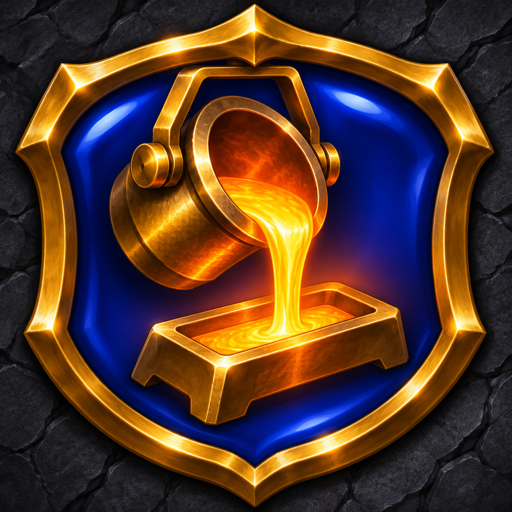
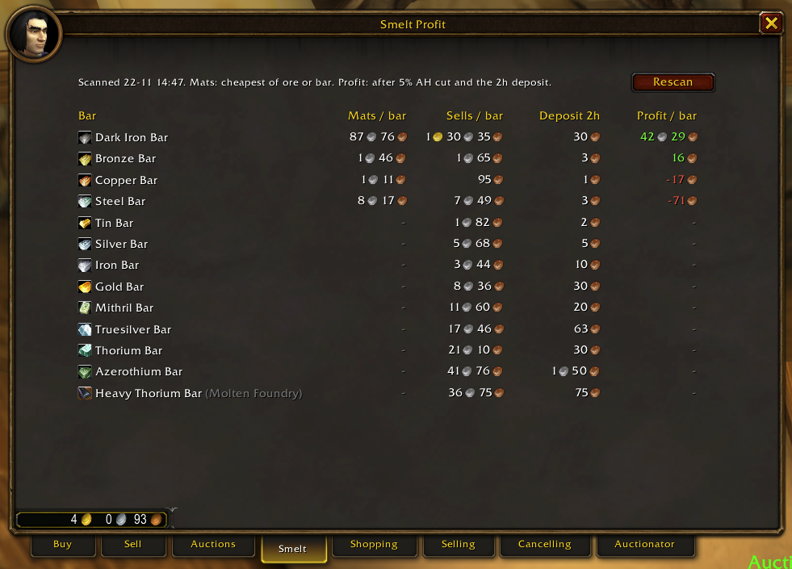

<p align="center"></p>

<h1 align="center">Smelt Profit</h1>

A World of Warcraft: Forever addon that scans every ore and bar on the auction house and shows which smelts turn a profit.



## What it does

Open the auction house and Smelt Profit scans all ores, bars, Coal and Pitchblende in one search. The **Smelt** tab at the bottom of the auction house then shows, per bar:

| Column | Meaning |
|---|---|
| Mats / bar | What the reagents cost for one bar. For Bronze and Steel it takes the cheapest route: buying the bars, or buying the ore and smelting it first. |
| Sells / bar | The cheapest listing of the bar, after the 5% auction house cut. |
| Deposit 2h | The deposit to list one bar for 2 hours. |
| Profit / bar | Sells minus mats minus deposit. Green is profit, red is loss. |

Bars with the best profit come first. A bar without listings, or with a missing reagent, shows `-` instead of a guess.

Covered smelts: Copper, Tin, Bronze, Silver, Iron, Gold, Steel, Mithril, Truesilver, Dark Iron, Thorium, and the Forever smelts Azerothium and Heavy Thorium (needs a Molten Foundry).

## Installation

**CurseForge app:** search for *Smelt Profit* and click Install.

**Manual:**

1. Download the latest zip from CurseForge or the [GitHub releases](https://github.com/dannyklaassen/wow-forever-smelt-profit/releases).
2. Unzip it into `World of Warcraft/_forever_/Interface/AddOns/`. You should end up with `Interface/AddOns/SmeltProfit/SmeltProfit.toc`.
3. Restart the game, or type `/reload` if it is already running.

## Commands

| Command | What it does |
|---|---|
| `/smelt` | At the auction house: opens the Smelt tab. Elsewhere, for example at the forge: opens the last scan in a separate window. |

## Good to know

- Prices are the single cheapest listing. If only one cheap ore is listed, the profit looks better than it is for a full stack.
- The deposit counts as a cost. In WoW you get it back when the bar sells, so the profit shown is the worst case.
- After the scan, Blizzard's own Buy list shows the ores and bars. Click the star to get your favorites back.
- The tab is added with [LibAHTab](https://github.com/Auctionator/LibAHTab), the same library Auctionator uses, so tabs from both addons sit next to each other without breaking your bags.

## Development

`check.lua` tests the profit math, the reading of scan results and the sort order. The release workflow runs it before packaging, so a broken calculation never reaches CurseForge. Run it yourself from the addon folder:

```bash
lua check.lua
```

It is excluded from the release package through `.pkgmeta`.

## License

[MIT](LICENSE). LibAHTab (MIT) and LibStub (public domain) are included in `Libs/` under their own licenses.
